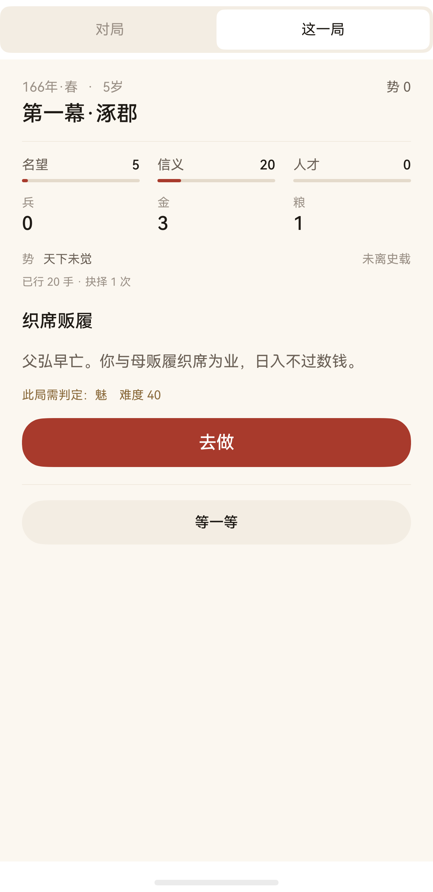

# Harmony Harness Game

[](https://github.com/QtePP/Harmony-harness-game/actions/workflows/payload.yml)

**dsh 鸿蒙外壳上的游戏应用。** 三国人生模拟：你扮演刘备，从 161 年涿县出生，
走完他生命里的十二个岔路口。你可以照史载走，也可以随时离开它。



*这一局：名望、信义、人才，和一次待判定的选择。*

这个仓是从 [harmony-go](https://github.com/QtePP/harmony-go)（外壳本体，原名
deepseek-harness-harmony）分出来的**垂域仓**：外壳只提供会话、文件、审批、设置；游戏归这里。

---

## 离线 demo（不用装 App）

在线试玩：<https://qtepp.github.io/Harmony-harness-game/>

[`demo/sanguo.html`](demo/sanguo.html)（三国 · 长页）、[`demo/card.html`](demo/card.html)
（三国 · 4:6 单卡）和 [`demo/life.html`](demo/life.html)（人生之书 · 4:6 单卡）都是单文件
离线版：下载后用浏览器打开即可，不需要 API Key、不需要网络、不需要 Node。
它复用同一套引擎和十二幕 38 个场景，结局由第十一幕称帝、第十二幕夷陵/白帝的关键选择与末局
数值决定；点「本机推演」可以按仁 / 霸 / 稳 / 隐四种倾向自动走完一生，全程不调用模型。
构建与验收见 [`demo/README.md`](demo/README.md)。

---

## 为什么单独一个仓

外壳的产品身份是「一个能跑 dsh 的通用会话界面」。垂域内容（游戏、旅行、饮食）如果长在外壳里，
外壳就会认识"航班""抽卡""卡路里"这些概念，然后每个垂域都要在外壳里加一套状态模型和渲染。

判据：**这块 UI 能不能被另一个垂域复用？** 不能，就该在垂域仓。

所以这里带着外壳的完整历史（`git clone` 自外壳），加上游戏专属的三层：

| 层 | 位置 | 是什么 |
|---|---|---|
| **裁判引擎** | `host/profile-ohos/.../@ohos/dsh-sanguo/` | 随载荷分发的 dsh 插件：掷骰、判成败、算数值、推演势力、记人物记忆 |
| **原生前端** | `entry/.../model/SanguoBoard.ets`、`entry/.../view/SanguoBoardView.ets` | 读 `.sanguo/life.json` 投影的棋盘；手机顶部切换器、平板 340vp 右栏 |
| **Agent pack** | `agents/sanguo-life/` 等五个 | `AGENTS.md` + `.dsh/skills/` + `cards/`，整包拷进 workspace 即生效 |

---

## 为什么引擎必须是插件

本 profile 跑 `tools.mode: native`，`run_code` **不在**模型工具表里
（`dsh-tools` 只在非 native 模式注入），`bash` 又被 patch 移除（鸿蒙禁 fork/exec）。
所以工作区里放一个 `.js` 引擎 = 一个没有任何东西能执行的文件。

引擎只能随载荷分发成插件，模型通过五个工具调用它：

```
sanguo_new      开一局（只在玩家明确要求时用，会覆盖存档）
sanguo_status   看处境，不改状态
sanguo_choose   在抉择节点选一个已声明选项（要 option id，不是序号）
sanguo_act      选项之外的事，走能力判定
sanguo_advance  让世界自己走一季
```

---

## 两种判定，两种人生

引擎里有两套完全不同的机制，对应刘备一生里两种完全不同的时刻：

| | 能力判定 | 仁义抉择 |
|---|---|---|
| 什么时候 | "我能不能做到" | "我愿意付什么代价" |
| 掷骰 | **掷**（1d100 + 属性 + 修正） | **不掷** |
| 谁决定 | 骰子 | 玩家 |

**为什么分开**：如果把"携民渡江"也做成掷骰，这个游戏讲的就是运气，不是人。
历史上它没有失败——它让他失去了一切物质，却在十年后买回了荆州和益州。

模型可以**建议**用哪个属性、难度多少，但两者都会被夹到合法区间（10–95）再掷，
所以建议能影响一次判定，不能让成功变成必然、也不能让失败变成注定。

## 「势」：偏离史载的代价，不是禁令

```
偏离一次史载  → 势 +10
实力不足硬来  → 势 +（缺口 × 0.5）
一季无所作为  → 势 −2
```

`势` 转成判定惩罚（上限 −30）并改变天下对你的评语（天下未觉 → 举世皆敌）。
**它永远不否决你。** 一个把势拉满的玩家面对的是一个处处与他为敌的世界，但世界仍然可以玩。
这是模拟和轨道的区别。

## 世界不等你

每季（一回合 = 一季）独立推演：强弱悬殊（2.4 倍）且**接壤**的势力会取地、各势力本州
（`home`）防御更高、按史实年份出场与退场（孙权 200 年才登场，董卓 192 年后失地）。
在新野坐等五年，曹操照样统一河北、刘表照样病死、刘琮照样投降。

---

## 怎么跑

和外壳完全一样的构建链：

```bash
node scripts/assemble-payload.mjs    # 把插件打进载荷（默认钉 dsh 0.2.1-rc.4）
bash scripts/deploy.sh               # 签名 + 构建 + 装机
bash scripts/test.sh                 # 全部检查：单测 / ArkTS / LocalUnit / 设备
```

### 独立安装包（与 HarmonyGo 并存）

这个游戏最初和外壳同包名，装机就会顶掉外壳。现在它是一个**能并排安装的独立应用**：

| 项 | 值 | 为什么 |
|---|---|---|
| bundleName | `com.qtepp.sanguo` | 和 `com.qtepp.harmonygo` 不同，互不覆盖 |
| 显示名 / 图标 | 三国人生 / 汉印 | 桌面上不会和闪电图标的 HarmonyGo 混淆 |
| 桥端口 | **4518** | HarmonyGo 占 4517；两个应用可以同时常驻，否则后启动的那个 `EADDRINUSE` |
| 默认 profile | **ACP** | 只有 ohos profile 挂 `@ohos/dsh-sanguo`；SDK 下模型根本看不到 `sanguo_*` 工具 |
| 思考深度 | **low**（新会话默认） | 引擎负责判定，模型只叙述；high 会把一轮拖到 13s，low 实测 2.3s |
| 本机引擎 | **4519** | 棋盘按钮直连引擎，毫秒级结算；失败自动回退到模型 |

棋盘的「去做 / 等一等 / 选项」现在先走 `127.0.0.1:4519` 的本机引擎，聊天里标「本机引擎」；
旧载荷、端口占用、超时都会自动回退到模型。`开始/重开` 和自由输入仍走模型。
本机回合只写存档 + App 消息，不写 ACP 会话历史；之后自由输入时模型可能先 `sanguo_status`
对齐，这是预期。详见 [SPECULATIVE-TURNS.md](docs/SPECULATIVE-TURNS.md)。

首次启动：启动页提示缺 Key → 点「设置」→ 填 DeepSeek API Key → 保存 → 重试。
之后新建项目「汉末人生」→ 粘下面的建包指令 → 模型落盘并直接开局。

开局：新建项目「汉末人生」→ 把 `agents/sanguo-life/BOOTSTRAP.md` 里
`---` 之间的那段粘进第一个对话 → 模型落盘并直接开始第一幕。

棋盘入口：项目 workspace 里出现 `.sanguo/` 后，手机顶部会出现「对局 / 这一局」切换器，
平板则是聊天右侧的 340vp 棋盘栏。

---

## 内容边界（诚实清单）

- **十二幕已写**：涿郡（0–23）→ 安喜（23–29）→ 平原（30–32）→ 徐州（33–35）→
  许都（36–40）→ 新野（41–46）→ 长坂（47）→ 赤壁（47–48）→ 益州（50–53）→
  汉中（54–58）→ 荆州（58–60）→ 白帝（60–62）。38 个场景。
- **结局层只在 demo 里**：引擎走到白帝之后 `act = "end"`；`demo/endings.js` 按末局数值与
  关键选择给出 8 个结局文本。
- **没有 NPC 对话工具**。人物有态度和记忆，但对话由模型基于 digest 讲，不落状态。
- **没有存档管理 UI**。存档在 `.sanguo/save.json`，可手改、可拷走，但应用里没有读档入口。

## 目录

| 路径 | 作用 |
|---|---|
| `host/profile-ohos/.../@ohos/dsh-sanguo/` | 裁判引擎（`engine/` 六个纯 JS 模块 + `data/acts.json` + 97 个单测） |
| `entry/src/main/ets/model/SanguoBoard.ets` | 投影解析（把 `.sanguo/life.json` 读成棋盘状态） |
| `entry/src/main/ets/model/SanguoRun.ets` | 从 `save.json` + `history.jsonl` 算走势（「势」的柱状轨迹） |
| `entry/src/main/ets/view/SanguoBoardView.ets` | 棋盘本体 |
| `agents/sanguo-life/` | 能真的玩的 pack（引擎驱动） |
| `agents/sanguo-guide/` | 带自有设定集的三国向导（四源标注） |
| `agents/match-coach/`、`openworld-guide/`、`story-guide/` | 三种不同输出契约的陪玩 pack |
| `demo/` | 单文件离线 demo（三国 `sanguo.html` / `card.html`；人生之书 `life.html`）+ 构建 + 结局可达性验收 |
| `examples/counter-example-travel-card/` | **反例**：垂域状态卡片，保留作"我们不做这个"的证据 |

## 许可

MIT，与外壳一致。游戏内容（三国史实与演义）属公有领域；`agents/*/data/world/` 下的
用户设定集不入库。
